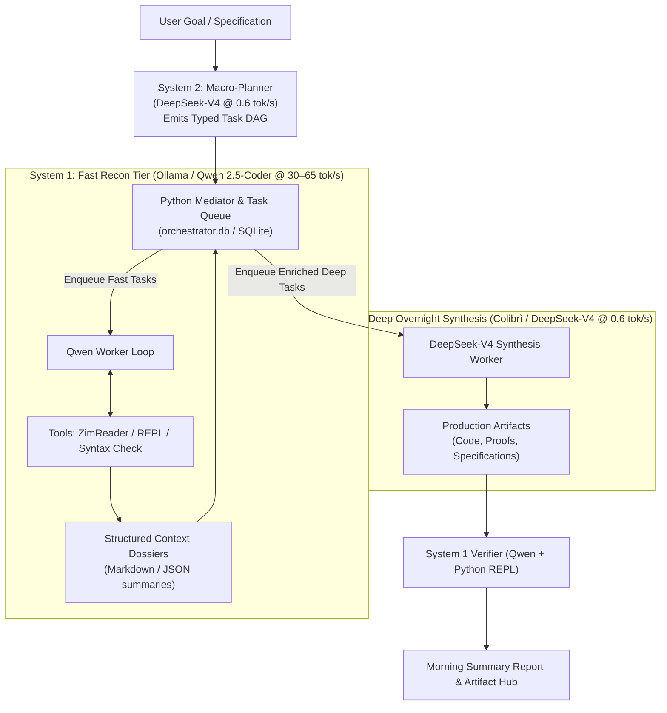
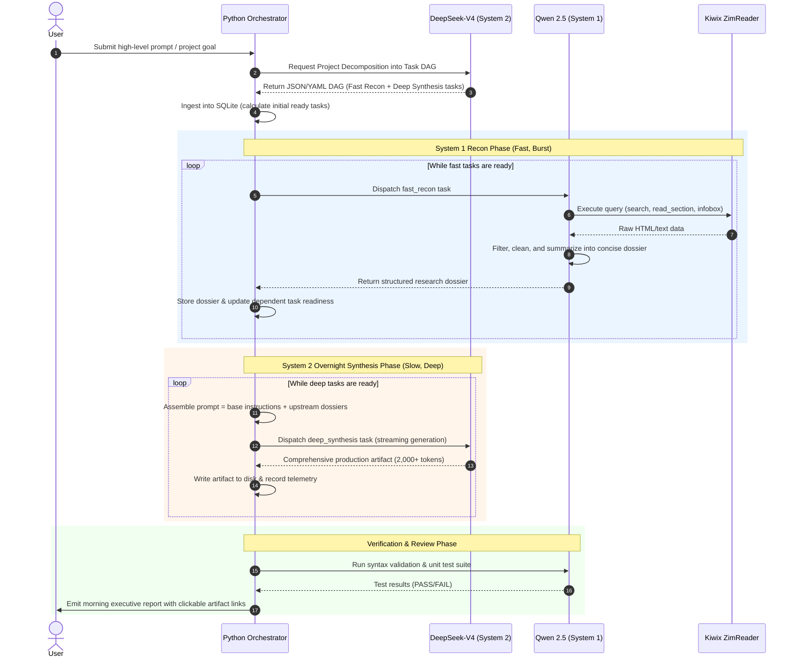

# Dual-Speed "System 1 / System 2" Orchestrator
## Architectural Design & Engineering Specification

> **Status:** Implemented as Baton ([`baton/`](file:///e:/dev/Antigravity/local_llm/baton/)) · Fully Operational & Tested  
> **Author:** Antigravity / Pair-Programming Agent  
> **Target Platform:** Windows 11 / WSL2 (Intel i5-13500, 128 GB RAM, NVIDIA RTX 3060 12GB)  
> **Date:** October 2026  

---

## 1. Executive Summary & Vision

Local Large Language Model (LLM) environments typically present an extreme trade-off:
- **Small Dense Models (7B–14B):** Ultra-fast (**28–65 tok/s**), responsive, and great at structured tool calling, but prone to cognitive limits on deep mathematical proofs, large multi-module architectures, and subtle domain reasoning.
- **Massive Sparse MoE Models (284B–321B):** Frontier-grade reasoning, deep domain competence (e.g. harmonic oceanography, advanced physics, distributed systems), but computationally heavy (**0.59–0.81 tok/s**) when run on consumer desktop memory systems.

Sitting at an interactive terminal waiting for a 2,800-token answer at 0.59 tok/s takes ~78 minutes. However, **human idle time is free**. 

The **Dual-Speed "System 1 / System 2" Orchestrator** resolves this friction by introducing an asynchronous, mediator-driven architecture:
1. **System 2 (Deep Macro-Planner & Overnight Synthesizer):** Powered by **DeepSeek-V4-Flash (284B MoE)** or **GLM-5.3-Flash (321B MoE)** via Colibrì. Decomposes high-level project goals into a Directed Acyclic Graph (DAG) of discrete tasks, and executes long, unattended deep synthesis passes overnight.
2. **System 1 (Fast Recon & Tool-Calling Worker):** Powered by **Qwen 2.5-Coder (7B/14B)** via Ollama. Rapidly executes high-throughput subtasks: offline Wikipedia lookups via [`smart_search/zim_reader.py`](file:///e:/dev/Antigravity/local_llm/smart_search/zim_reader.py), code linting, web searches, syntax verification, and JSON extraction at 30–60 tok/s.
3. **The Python Mediator (Durable DAG Queue):** A lightweight SQLite-backed engine that coordinates task dependencies, builds enriched "briefing dossiers" from System 1 recon, and dispatches them to System 2 for nocturnal execution.

---

## 2. High-Level Architecture



---

## 3. Tier Roles & Hardware Mapping

| Attribute | System 1 (Fast Recon & Verifier) | System 2 (Deep Synthesis) | The Mediator |
| :--- | :--- | :--- | :--- |
| **Engine / Backend** | Ollama (CUDA Windows Daemon) | Colibrì (`deepseek_v4` via WSL2 CUDA) | Native Python 3.11 (`Anaconda3`) |
| **Model** | **`qwen3:14b`** (General Recon & Knowledge)<br>**`qwen2.5-coder:14b`** (Code Verification & Linting) | `DeepSeek-V4-Flash` (284B MoE) | None (Deterministic logic) |
| **Quantization** | Q4_K_M (~9 GB VRAM) | Native FP8 dense + FP4 MoE (~156 GB) | N/A |
| **Throughput** | **14 – 28 tokens/sec** | **0.59 – 0.81 tokens/sec** | Instantaneous (<1 ms) |
| **Hardware Placement** | 100% RTX 3060 VRAM (~9 GB) | 6.27 GB in VRAM + 82 GB in RAM | Minimal CPU + SQLite DB |
| **Primary Tasks** | **Recon:** Wiki/ZIM search, GIS lookup, entity traversal, dossier compilation (`qwen3:14b`).<br>**Verification:** Code syntax, `ruff` linting, `pytest` validation (`coder:14b`). | Architectural design, multi-file code synthesis, mathematical proofs. | DAG dependency tracking, state persistence, context budgeting. |
| **Execution Window** | Burst interactive / Daytime pre-pass | Unattended nocturnal batch (~6–8 hours) | Continuous background daemon |

---

## 4. Hardware Coexistence & Operational Modes

On this desktop (Intel i5-13500, 128 GB RAM, NVIDIA RTX 3060 12GB VRAM), the orchestrator can operate in two distinct scheduling modes:

### Mode A: Interleaved / Phase-Based Scheduling (Recommended)
In this mode, only one model tier actively holds GPU compute at any given time:
1. **Evening (Planning):** DeepSeek-V4 loads, processes the user goal, generates the task graph in 5–8 minutes, then releases or idles GPU resources.
2. **Pre-Flight (Fast Recon):** Ollama activates with `qwen3:14b`. In 15–30 minutes, it executes 30+ Wikipedia/ZIM research lookups, extracts constants, parses documentation, and populates research tables.
3. **Overnight (Deep Synthesis):** Colibrì launches DeepSeek-V4 with `--ram 82` and `DSV4_CUDA_EXPERT_MIRRORS=0`. It runs for 6–8 hours uninterrupted, generating comprehensive implementations.
4. **Dawn (Post-Flight Linting):** Ollama activates with `qwen2.5-coder:14b` for a quick 5-minute automated test/lint pass across the generated code.

*Advantage:* Zero resource contention, maximum RAM available to each engine, zero risk of CUDA Out-Of-Memory (OOM).

### Mode B: Concurrent Coexistence (True Dual-Engine)
Both models remain loaded simultaneously:
- **VRAM Breakdown (12.0 GB Total):**
  - DeepSeek-V4 dense attention: **6.27 GB**
  - `qwen2.5-coder:7b` (Q4_K_M): **~4.70 GB**
  - Combined VRAM: **~10.97 GB** (fits cleanly within 12.0 GB).
- **RAM Breakdown (128 GB Total):**
  - DeepSeek-V4 expert cache: **82.0 GB**
  - Host OS + Ollama process overhead: **~18.0 GB**
  - Total RAM used: **~100.0 GB** (~78% host RAM, ~28 GB headroom).

*Advantage:* System 1 can dynamically verify and parse outputs in real time while System 2 is producing intermediate files.

---

## 5. Task DAG Specification & Data Model

The core contract between System 2 (Planner) and the Python Mediator is a structured **Task DAG**.

### A. Task Specification Schema

```yaml
version: "1.0"
project: "Offline Solar Ephemeris & Orbital Mechanics"
goal: "Build an accurate numerical solar position predictor with zero internet connectivity."

tasks:
  - id: "recon_meeus_formula"
    type: "fast_recon"
    tier: "system_1"
    tool: "wiki_read_section"
    params:
      title: "Position of the Sun"
      section: "Ecliptic coordinates"
    description: "Extract the low-precision formula for solar mean longitude and anomaly from Jean Meeus."

  - id: "recon_obliquity_constants"
    type: "fast_recon"
    tier: "system_1"
    tool: "wiki_infobox"
    params:
      title: "Axial tilt"
    description: "Extract current standard obliquity of the ecliptic constants and J2000 epoch offsets."

  - id: "deep_math_derivation"
    type: "deep_synthesis"
    tier: "system_2"
    depends_on: ["recon_meeus_formula", "recon_obliquity_constants"]
    prompt: |
      Using the extracted orbital formulas and constants in the attached briefing dossier:
      Derive a vectorized Python class `SolarEphemeris` using NumPy.
      Implement right ascension, declination, and equation of time. Include unit tests.
    output_artifact: "solar_ephemeris.py"
    estimated_tokens: 2500

  - id: "verify_syntax_and_tests"
    type: "fast_verify"
    tier: "system_1"
    depends_on: ["deep_math_derivation"]
    tool: "python_eval"
    params:
      script_path: "solar_ephemeris.py"
    description: "Run unit tests and verify zero import or syntax errors."
```

### B. SQLite Database Schema (`orchestrator.db`)

To ensure durability across system reboots or long runs, state is maintained in SQLite:

```sql
-- Core job container
CREATE TABLE IF NOT EXISTS jobs (
    job_id TEXT PRIMARY KEY,
    title TEXT NOT NULL,
    status TEXT CHECK(status IN ('pending', 'running', 'completed', 'failed')) DEFAULT 'pending',
    created_at TIMESTAMP DEFAULT CURRENT_TIMESTAMP,
    completed_at TIMESTAMP
);

-- Individual tasks within the DAG
CREATE TABLE IF NOT EXISTS tasks (
    task_id TEXT PRIMARY KEY,
    job_id TEXT NOT NULL,
    title TEXT NOT NULL,
    tier TEXT CHECK(tier IN ('system_1', 'system_2')) NOT NULL,
    task_type TEXT NOT NULL,
    status TEXT CHECK(status IN ('blocked', 'ready', 'in_progress', 'completed', 'failed')) DEFAULT 'blocked',
    prompt_template TEXT,
    tool_name TEXT,
    tool_params TEXT, -- JSON
    result_payload TEXT,
    artifact_path TEXT,
    tokens_generated INTEGER DEFAULT 0,
    elapsed_seconds REAL DEFAULT 0.0,
    created_at TIMESTAMP DEFAULT CURRENT_TIMESTAMP,
    started_at TIMESTAMP,
    completed_at TIMESTAMP,
    FOREIGN KEY(job_id) REFERENCES jobs(job_id)
);

-- Task dependency graph edges
CREATE TABLE IF NOT EXISTS task_dependencies (
    task_id TEXT NOT NULL,
    depends_on_task_id TEXT NOT NULL,
    PRIMARY KEY(task_id, depends_on_task_id),
    FOREIGN KEY(task_id) REFERENCES tasks(task_id),
    FOREIGN KEY(depends_on_task_id) REFERENCES tasks(task_id)
);
```

---

## 6. Execution Lifecycle: Step-by-Step



---

## 7. System 1 Offline Tool Ecosystem & Sensor Subsystems

> **Dedicated Specification Document:** See [`offline_tools_design.md`](file:///e:/dev/Antigravity/local_llm/docs/offline_tools_design.md) for full architectural schemas, data source downloads, SDR hardware details, and storage layouts.

System 1 acts as the **"Field Scout & Sensor Hub"** for the orchestrator. Rather than dumping raw web pages, gigabytes of map data, or raw signal dumps into System 2, System 1 utilizes 5 specialized local tool subsystems to synthesize dense, verified 300-word briefing dossiers:

| Subsystem | Tool Engine & Storage | Capabilities & Use Cases |
| :--- | :--- | :--- |
| **A. Code & Sandboxing** | `python_eval` sandbox (ephemeral dir), `ruff` (<15ms linter), `pytest` | Validates intermediate calculations, lints generated code, runs automated unit test matrices. |
| **B. Offline Knowledge** | `libzim` reader on `E:\offline_data\zim\` (Wikipedia, Stack Overflow, WikiMed, Gutenberg) | Rapid full-text search, section extraction, and infobox parsing across 200+ GB of offline technical literature. |
| **C. Geospatial & DEM** | `DuckDB`/`pyrosm` (OSM `.pbf`) + NASA SRTM 30m elevation rasters | Infrastructure geocoding, topological road graphs, point elevation, and RF line-of-sight / Fresnel clearance calculations. |
| **D. SDR & Telemetry** | RTL-SDR v4 USB dongle + `noaa-apt`, `direwolf`, `dump1090` | Over-the-air public signals: NOAA weather satellite imagery (137 MHz), APRS ham weather packets (144.39 MHz), ADS-B aircraft tracking. |
| **E. Celestial Ephemeris** | `skyfield` (DE421 ephemeris) + `sgp4` (NORAD TLEs) + harmonic tides | High-precision solar/lunar vectors, satellite pass predictions (AOS/LOS), solar panel irradiance, and predictive tide cycles. |

System 1 condenses multi-megabyte datasets down to **300-word structured briefing dossiers**, reserving System 2's bounded 4,096-token context window exclusively for deep generation.

---

## 8. Principles & Engineering Guardrails

Building on lessons learned from the `smart_search` benchmark suite and the Realtek Wi-Fi watchdog:

1. **Honest Broker Principle (No Babysitting):**
   - If a generated code module fails execution in the verification step, the failure is recorded faithfully. The system does not silently patch or mask errors.
   - Failures trigger an automated revision subtask in the DAG rather than infinite silent loops.

2. **Strict Context Budgeting:**
   - DeepSeek-V4 runs with a context window of **4,096 tokens** by default.
   - When Python compiles the upstream briefing dossier, it truncates or summarizes dependencies so prompt context never exceeds **1,200 tokens**, reserving **2,800+ tokens** for the model's deep output generation.

3. **Execution Watchdogs & Subprocess Isolation:**
   - Every tool call made by System 1 features a **60-second execution watchdog** (`taskkill /F /T` on Windows) to prevent stalled regex or infinite loops.
   - System 2 API requests feature long HTTP read timeouts (e.g. 5,400 seconds) to accommodate 78-minute generation runs without socket termination.

4. **Power & Thermal Sustainability:**
   - During continuous overnight execution, Intel CPUs naturally step down from PL2 (154W boost) to PL1 (65W base).
   - The engine generates at a quiet, thermally stable **~0.6 tok/s**, consuming minimal power and avoiding noisy fan ramping.

---

## 9. Implementation Status & Evolution (Baton)

All architectural phases have been built and verified in the [`baton/`](file:///e:/dev/Antigravity/local_llm/baton/) codebase:

### Phase 1: Core Orchestrator Skeleton (`baton/`) — ✅ Complete
- `baton/models.py`: Pydantic schemas for `Task`, `Job`, `Tier`, `TaskStatus`, `DAGPlan`, `Artifact`, `TaskProgress`.
- `baton/db.py`: SQLite state machine (`baton.db`), deterministic dependency resolution, cycle detection, cascading status transitions.

### Phase 2: Model Clients & Tool Connectors — ✅ Complete
- `baton/system1.py`: Ollama client (`qwen3:14b`) running fast recon loops, extracting Wikipedia ZIM sections, compiling 300-word structured briefing dossiers.
- `baton/system2.py`: Colibrì OpenAI-compatible client (`deepseek-v4-colibri`) executing deep synthesis with live SSE streaming, thinking monologue capture (`_thinking.md`), and artifact production.
- `baton/tools/zim.py`: Offline Kiwix Wikipedia reader (search, lead, section, infobox, TOC).
- `baton/engine_manager.py`: Mode A supervisor guaranteeing GPU mutual exclusion between Ollama and Colibrì.

### Phase 3: Macro-Planner & DAG Engine — ✅ Complete
- `baton/system2.py`: `plan_project()` prompts System 2 to decompose user goals into typed DAGs with dependencies and context budgeting.
- DAG ingestion with cycle detection and automatic readiness cascading.

### Phase 4: CLI & Batch Orchestrator — ✅ Complete
- `baton.cmd` / `baton/cli.py`: Commands for `status`, `step`, `stop`, `run`, `new`, `retry`, `submit`, `artifacts`.

### Phase 5: Production Hardening, TUI & Resilience — ✅ Complete
- **Interactive Textual TUI (`baton/tui_textual.py`):** Two-pane interface with live task priority table, real-time streaming inspector (monologue + code drafting), modals for task creation (`n`) and editing (`Space`), and auto-tick mode (`t`).
- **Live SSE Streaming Progress:** Real-time updates written atomically to `baton/artifacts/progress/<task_id>.json` with tokens/sec telemetry.
- **Mid-Stream Task Cancellation (`s` / `S`):** Non-destructive cancellation via `cancel_active()` and `orchestrator.stop_current_task()`, avoiding process kills.
- **Degenerate Repetition Detection:** Real-time cycle/repetition monitor (`check_degenerate_repetition`) in `System2Runner` aborts infinite token loops (e.g. `00000...`) cleanly while preserving valid code.
- **Context Ceiling Diagnosis & Multi-Turn Continuation:** Bounded context ceilings in Colibrì (`finish_reason == "length"`) are detected and seamlessly resumed across multiple turns using trailing unclosed `assistant` turns via `resolve_generation_prompt`.

### Phase 6: System 1 Interactive Chat Copilot (`baton/chat.py`) — ✅ Complete
- **Zero-Latency Readline Interface:** Built with `prompt_toolkit`, avoiding terminal redraw lag and offering smooth multi-line editing and history.
- **Native Ollama Tool Calling:** Qwen 14B autonomously queries tools to inspect tasks, queue work, step executions, and read artifacts.
- **Instant Slash Commands:** Direct <1ms commands (`/shelf`, `/bundle`, `/tasks`, `/status`, `/artifacts`, `/step`, `/model`).

### Phase 7: Dynamic Tool Shelf Architecture & Bundle Isolation — ✅ Complete
- **Context Protection:** Modular tool bundles prevent schema token bloat and hallucinated tool calls on 14B models.
- **Registered Bundles:**
  - `'core'`: Baseline shelf manager (`list_tool_bundles`, `activate_tool_bundle`, `deactivate_tool_bundle`).
  - `'baton'`: Task queue mutations & stepping (`add_task`, `delete_task`, `retry_failed_tasks`, `queue_status`, `step_queue`, `list_tasks`, `get_task`, `list_artifacts`, `read_artifact`).
  - `'wikipedia'`: Offline Kiwix ZIM Wikipedia lookup.
  - `'newsboat'`: Offline RSS news monitoring.
- **Research Agent Isolation:** Dedicated System 1 research agents (or `chat --research`) initialize with `initial_bundles={"core", "wikipedia"}` or `{"core", "newsboat"}` without queue tools in context, eliminating accidental queue edits.

### Phase 8: Offline RSS Ingestion (`baton/tools/newsboat.py`) — ✅ Complete
- **WSL Newsboat Snap:** Feeds cached to `baton/data/rss/cache.db`.
- **Safe Read-Only URI Mode:** `file:...cache.db?mode=ro`, `uri=True` prevents lock collisions.
- **HTML to Markdown Sanitization:** `clean_html()` strips bloat and produces token-efficient summaries.

### Phase 9: Multi-Model Router Architecture & VRAM Budget Optimization — ✅ Complete
- **Multi-Model Router (`llama-server :8080`):** Single server process serves both System 1 (`qwen3:14b`) and System 2 (`ornith-1.5-35b-a3b`) via `models_preset.ini`.
- **VRAM Envelope Preservation:** Enforces `parallel=1`, `cache-type-k=q8_0`, `cache-type-v=q8_0`, and 8192 context on Qwen3, keeping total allocation within the 12GB RTX 3060 boundary and preventing PCIe paging stalls (>50x speedup from 0.6 tok/s to 32 tok/s).
- **RAM Swapping:** Models dynamically page between 128GB host RAM and 12GB VRAM on demand (~1.1s eviction time).

### Phase 10: Autonomous Recon Self-Recovery & Reasoning Code Salvage — ✅ Complete
- **System 1 Autonomous Recon Self-Recovery:** Automatically diagnoses tool lookup misses, empty results, or typos (`_is_recon_miss`), queries ZIM suggestion indexes, and uses structured JSON self-repair to diagnose and re-dispatch the corrected tool and parameters.
- **System 2 Decisive Reasoning & Code Salvage Fallback:** Prompts instruct decisive planning in `<think>` (<1000 tokens) and immediate conclusion with `</think>`. If generation reaches token limits before closing the reasoning block, the engine automatically extracts and salvages code blocks from the `reasoning_content` monologue.
- **Downstream Verification Auto-Draining:** `start_orchestration` executes downstream `FAST_VERIFY` tasks queued immediately following System 2 synthesis in the same run.
- **Unit Test Suite:** **179/179 unit and integration tests passing** across 17 test modules.


