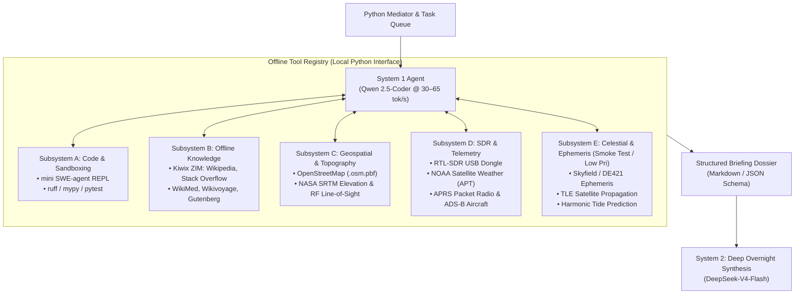
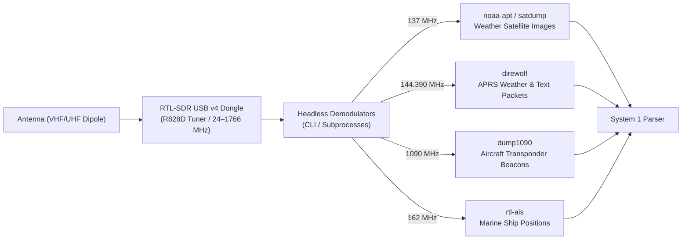

# System 1 Offline Tool Ecosystem & Sensor Subsystems
## Engineering Specification for Sovereign, Air-Gapped Agent Capabilities

> **Status:** Architecture & Tool Specification Document  
> **Author:** Antigravity / Pair-Programming Agent  
> **Target Platform:** Windows 11 / WSL2 (Intel i5-13500, 128 GB RAM, NVIDIA RTX 3060 12GB)  
> **Companion Document:** [`dual_speed_orchestrator_design.md`](file:///e:/dev/Antigravity/local_llm/docs/dual_speed_orchestrator_design.md)  
> **Date:** October 2026  

---

## 1. Executive Summary & Design Principles

The **Dual-Speed Orchestrator** pairs a massive, slow reasoning engine (System 2: DeepSeek-V4-Flash / GLM-5.3-Flash @ ~0.6–0.8 tok/s) with a high-throughput, low-latency worker (System 1: Qwen 2.5-Coder @ 30–65 tok/s). 

While System 2 provides the raw cognitive depth, **it is blind to the physical world and dumb without context**. 

This document defines the **System 1 Offline Tool Ecosystem**: an air-gapped, zero-cost, sovereign suite of sensors, sandboxes, and knowledge bases that turn the System 1 agent into an autonomous **"Field Scout & Sensor Hub"**. By querying local databases, analyzing geospatial maps, and reading over-the-air radio telemetry, System 1 compiles dense, verified briefing dossiers for System 2 without touching the internet.

### Core Principles
1. **Zero Cloud Dependencies:** Every data store, knowledge archive, and sensor must function completely offline with zero external API subscriptions or data telemetry.
2. **Asymmetric Storage Placement:** Use fast NVMe (`C:\`) strictly for active LLM models; place massive static datasets (OpenStreetMap, DEM elevation rasters, Kiwix ZIM archives) on high-capacity secondary SSD/HDD storage (`D:\` 2TB, `E:\` 3TB).
3. **Token Economy Distillation:** System 1 never dumps raw HTML, multi-megabyte CSVs, or entire Wikipedia pages into System 2's context window. It acts as an aggressive compressor, turning 20,000 words of raw source data into **300-word structured mathematical/technical dossiers**.
4. **Deterministic Sandboxing:** Tools must fail safely. External subprocesses run with strict timeouts, process tree termination, and structured JSON error schemas.

---

## 2. Tool Ecosystem Architecture



---

## 3. Subsystem A: Code Execution & Validation Sandbox

> **Detailed Specification:** [`subsystem_a_sandbox_design.md`](file:///e:/dev/Antigravity/local_llm/docs/subsystem_a_sandbox_design.md)  

Building upon the sandboxing patterns established in [`smart_search/run_agent.py`](file:///e:/dev/Antigravity/local_llm/smart_search/run_agent.py), System 1 has full programmatic access to safe execution environments.

### 1. Isolated Python REPL (`python_eval`)
- **Engine:** Python subprocess running in an ephemeral sandbox directory (`scratch/sandbox_<task_id>/`).
- **Safety & Process Control:**
  - Hard execution watchdog timer (default: **60 seconds**, exit code 124).
  - Windows process tree termination (`taskkill /F /T /PID`) to prevent orphaned subshells or background threads from hanging stdout/stderr pipes.
  - Dedicated virtual environment or Anaconda isolated prefix.
- **Use Case:** System 1 tests quick mathematical functions, validates regex, checks coordinate transforms, and runs sanity checks before presenting results to System 2.

### 2. Ultra-Fast Static Linters (`ruff` & `mypy`)
- **`ruff`:** Rust-based Python linter and formatter. Executes full codebase checks in **<15 milliseconds**.
  ```powershell
  ruff check --output-format json target_script.py
  ```
  Returns machine-readable JSON detailing exact line numbers, syntax errors, and undefined variables.
- **`mypy`:** Validates type signatures and contract alignment across multi-module designs.

### 3. Automated Test Suite (`pytest_eval`)
- Runs unit tests and emits a concise JSON test matrix (`{"passed": 12, "failed": 0, "errors": []}`).
- Eliminates human intervention in verifying whether DeepSeek's overnight code actually works.

---

## 4. Subsystem B: Offline Knowledge Stores (Kiwix ZIM Catalog)

Using the production-grade `libzim` reader implemented in [`smart_search/zim_reader.py`](file:///e:/dev/Antigravity/local_llm/smart_search/zim_reader.py), System 1 can query any `.zim` file format natively.

### Recommended ZIM Catalog & Storage Allocation

| Dataset | File Name / Spec | Storage Location | Size | Content / Role |
| :--- | :--- | :--- | :--- | :--- |
| **Wikipedia (English)** | `wikipedia_en_all_maxi_*.zim` | `E:\offline_data\zim\` | ~105 GB | Complete English Wikipedia with full text and infoboxes. |
| **Stack Overflow** | `stackoverflow.com_en_all_*.zim` | `E:\offline_data\zim\` | ~68 GB | Millions of verified coding, algorithm, and engineering Q&A solutions. |
| **WikiMed (Medical)** | `wikimed_en_all_maxi_*.zim` | `D:\offline_data\zim\` | ~4.5 GB | Comprehensive medical, pharmacological, and trauma care reference. |
| **Wikivoyage** | `wikivoyage_en_all_maxi_*.zim` | `D:\offline_data\zim\` | ~1.5 GB | Worldwide geography, routes, survival, and regional resources. |
| **Wikibooks** | `wikibooks_en_all_maxi_*.zim` | `D:\offline_data\zim\` | ~3.0 GB | Open-source textbooks (physics, organic chemistry, electronics, carpentry). |
| **Project Gutenberg** | `gutenberg_en_all_*.zim` | `E:\offline_data\zim\` | ~70 GB | Over 70,000 public domain literature and historical scientific works. |

### System 1 ZIM Tools Interface
```python
class ZimKnowledgeTool:
    def search(self, archive: str, query: str, limit: int = 5) -> list[dict]:
        """Ranked full-text search across specified ZIM archive with highlight snippets."""
        ...
    def read_section(self, archive: str, title: str, section: str) -> str:
        """Token-efficient clean Markdown extraction of a single section body."""
        ...
    def get_infobox(self, archive: str, title: str) -> dict:
        """Extracts structured key-value constants (atomic weights, orbital periods)."""
        ...
```

---

## 5. Subsystem C: Offline Geospatial & Topography

Enables spatial awareness, geographic routing, infrastructure discovery, and radio path modeling without Google Maps or internet GIS servers.

### 1. OpenStreetMap (OSM) Offline Extraction
- **Data Source:** Geofabrik regional `.osm.pbf` extracts (e.g., California ~1.2 GB; North America ~14 GB).
- **Processing Engine:** `DuckDB` (with Spatial extension) or `pyrosm` / `osmnx`.
- **System 1 Capabilities:**
  - **Infrastructure Queries:** *"Locate all radio towers, water treatment plants, hospitals, and airstrips within a 25 km bounding box."*
  - **Offline Geocoding & Reverse Geocoding:** Converts latitude/longitude to street addresses and geographic names via an offline SQLite spatial index.
  - **Road Network Graph Extraction:** Exports topological network graphs for shortest-path routing algorithms.

### 2. NASA SRTM Digital Elevation Models (DEM 30m / 90m)
- **Data Source:** NASA Shuttle Radar Topography Mission (SRTM) 1 arc-second (~30-meter resolution) raster tiles (`.hgt` files) stored on `D:\offline_data\elevation\`.
- **Processing Engine:** `rasterio` and `scipy.ndimage`.
- **System 1 Capabilities:**
  - **Point Elevation:** `get_elevation(lat, lon)` $\rightarrow$ returns ground altitude in meters above sea level (AMSL).
  - **Terrain Cross-Section Profiler:** Samples $N$ points along a great-circle path between Point A and Point B, outputting an elevation vector.
  - **RF Line-of-Sight & Fresnel Zone Clearance:**
    Given antenna heights $h_1, h_2$ and frequency $f$ (e.g. 144 MHz or 433 MHz), calculates if the 1st Fresnel zone clears all terrain obstacles between two coordinates:
    $$F_1 = 8.656 \sqrt{\frac{d_1 d_2}{f \cdot D}}$$
    Outputs clearance margin (in meters) and obstruction warnings directly into the briefing dossier.

---

## 6. Subsystem D: Software Defined Radio (SDR) & Public Telemetry

By connecting an inexpensive **RTL-SDR USB v4 dongle** (~$30) to an existing USB 3.0 rear port, System 1 gains direct physical access to ambient over-the-air radio signals.



### 1. NOAA & Meteor Weather Satellite Demodulation (137 MHz)
- **Mechanism:** Polar-orbiting weather satellites (NOAA-15, NOAA-18, NOAA-19) broadcast automatic picture transmission (APT) images during overhead passes.
- **Workflow:**
  1. System 1 checks the celestial pass predictor (Subsystem E) for upcoming satellite pass times.
  2. At pass onset, a lightweight cron/watchdog launches `rtl_fm` to record raw FM audio to a `.wav` file.
  3. Once the pass completes, System 1 invokes `noaa-apt` headless CLI to decode the audio into clean visible and infrared PNG satellite images.
  4. System 1 extracts cloud cover metrics and local storm fronts.

### 2. APRS Packet Telemetry via Direwolf (144.390 MHz)
- **Mechanism:** Amateur radio operators and automated weather stations transmit AX.25 digital packets on 144.390 MHz (North America).
- **Tool:** Headless `direwolf` software TNC.
- **Telemetry Parsed by System 1:**
  - Real-time local ambient weather: Temperature, wind speed/direction, barometric pressure, precipitation rate.
  - Mobile position beacons, search-and-rescue beacons, and emergency bulletin messages.

### 3. ADS-B Aircraft Transponders (1090 MHz)
- **Mechanism:** Aircraft broadcast Mode-S ADS-B transponder packets detailing ICAO hex code, callsign, altitude, ground speed, and GPS position.
- **Tool:** Headless `dump1090-fa` generating a local `aircraft.json` stream.
- **System 1 Tool:** `get_overhead_aircraft(radius_km=100)` $\rightarrow$ returns JSON list of nearby aircraft vectors.

---

## 7. Subsystem E: Celestial Mechanics & Ephemeris (Extremely Low Priority / Smoke Test)

> **Priority Status:** **Extremely Low Priority**. This subsystem serves primarily as a historical smoke test for validating Wikipedia knowledge extraction alongside code synthesis.

Deterministic astronomical modeling implemented using pure Python (`skyfield`, `astropy`, `sgp4`) and offline orbital data files.

### 1. High-Precision Planetary Ephemeris (`skyfield` + DE421)
- **Data File:** JPL DE421 ephemeris file (`de421.bsp`, ~14 MB).
- **System 1 Capabilities:**
  - Exact solar position (solar azimuth, elevation, solar noon, sunrise/sunset).
  - Lunar phase, moonrise/moonset, and percentage illumination.
  - Solar irradiance estimation for solar panel battery charging models.

### 2. Satellite Pass Prediction (NORAD TLE Orbit Propagation)
- **Engine:** Python `sgp4` using an offline snapshot of NORAD Two-Line Element (TLE) orbit files (`weather.tle`, `stations.tle`).
- **System 1 Capabilities:**
  - Calculates AOS (Acquisition of Signal), LOS (Loss of Signal), peak elevation angle, and azimuth for satellite radio reception passes.

### 3. Harmonic Tidal Modeling
- Deterministic astronomical tide prediction using the Darwinian harmonic constituent model generated by DeepSeek (M2, S2, N2, K1, O1, P1).

---

## 8. Subsystem F: Offline RSS Ingestion & Asynchronous News Monitoring

Provides ambient technical intelligence, scientific discovery feeds, and security advisories completely offline without ad tracking or live browser overhead.

### 1. Ingestion Engine & Storage Layout
- **Engine:** Newsboat CLI running in WSL2 Ubuntu (`/usr/local/bin/newsboat`), scheduled via periodic cron or on-demand fetch.
- **Config & URLs:** Stored in `baton/data/rss/urls` and `baton/data/rss/config`.
- **Database:** Local SQLite cache stored on secondary storage at `E:\dev\Antigravity\local_llm\baton\data\rss\cache.db`.
- **Safe Concurrent Access:** Python connects with SQLite URI read-only mode (`file:...cache.db?mode=ro`, `uri=True`), allowing System 1 agents to query feeds while Newsboat writes without database lock collisions.

### 2. System 1 Capabilities (`baton/tools/newsboat.py`)
- **`rss_list_feeds`:** Enumerates all configured RSS feeds with unread and total item counts.
- **`rss_latest`:** Retrieves most recent articles across selected feeds or all feeds, sorted chronologically.
- **`rss_search`:** Full-text SQLite search across article titles and content bodies for specific topics (e.g. quantum algorithms, solar storms, zero-days).
- **`rss_read_article`:** Extracts full article text sanitized with `clean_html()` to strip HTML markup while preserving Markdown structure, with strict character budgets (default: 3,500 chars).

### 3. Tool Shelf Integration
Subsystem F is packaged as the `'newsboat'` bundle on the Baton Tool Shelf. System 1 research agents can pull it from the shelf on demand (`activate_tool_bundle('newsboat')`) and return it when finished, keeping context windows lean.

---

## 9. Physical Hardware & Storage Layout

To ensure maximum performance and avoid filling the primary Windows OS drive, storage is mapped cleanly across existing disks:

```
C:\ (1TB Samsung 970 EVO Plus NVMe - Fast OS & Models)
├── colibri_models\
│   ├── DeepSeek-V4-Flash\       [156 GB - 48 shards]
│   └── glm-5.3-flash-int4\      [195 GB - 62 shards]
└── Users\Kyaac\.ollama\models\  [~25 GB - Qwen & DeepSeek-Coder]

D:\ (2TB WD Blue SATA SSD - High-Speed Auxiliary Data)
├── offline_data\
│   ├── zim\
│   │   ├── wikimed.zim          [4.5 GB]
│   │   └── wikivoyage.zim       [1.5 GB]
│   ├── elevation\
│   │   └── srtm_30m\            [~25 GB - Regional DEM GeoTIFFs]
│   └── ephemeris\
│       ├── de421.bsp            [14 MB]
│       └── tles\                [~5 MB]

E:\ (3TB WD Blue HDD - Massive Cold Knowledge & GIS Archives)
├── dev\Antigravity\local_llm\   [Workspace & Git Repo]
└── offline_data\
    ├── zim\
    │   ├── wikipedia_en.zim     [105 GB]
    │   ├── stackoverflow.zim    [68 GB]
    │   └── gutenberg.zim        [70 GB]
    └── osm\
        └── north_america.osm.pbf [~15 GB]
```

---

## 10. System 1 Tool Registry Interface (`tool_registry.py`)

All tools expose a standard, declarative contract compatible with Qwen 2.5's function-calling engine:

```python
from dataclasses import dataclass
from typing import Any, Callable

@dataclass
class ToolDefinition:
    name: str
    description: str
    parameters: dict[str, Any]
    handler: Callable[..., dict[str, Any]]

class ToolRegistry:
    def __init__(self):
        self._tools: dict[str, ToolDefinition] = {}

    def register(self, tool: ToolDefinition) -> None:
        self._tools[tool.name] = tool

    def get_schemas(self) -> list[dict]:
        """Returns JSON schema list for Ollama function calling."""
        return [
            {
                "type": "function",
                "function": {
                    "name": t.name,
                    "description": t.description,
                    "parameters": t.parameters,
                }
            }
            for t in self._tools.values()
        ]

    def execute(self, name: str, arguments: dict) -> dict[str, Any]:
        if name not in self._tools:
            return {"status": "error", "message": f"Unknown tool: {name}"}
        try:
            result = self._tools[name].handler(**arguments)
            return {"status": "success", "result": result}
        except Exception as e:
            return {"status": "error", "message": str(e)}
```

---

## 11. End-to-End Walkthrough: Autonomous Expedition Link Planner

To illustrate how these tools interact during an actual user workflow:

1. **User Request:**  
   *"Design an autonomous VHF/UHF telemetry relay station between coordinate A (37.77, -122.41) and coordinate B (37.90, -122.55). Calculate antenna height requirements, check Fresnel terrain clearance, query local weather packets for barometric trends, and write a complete Python simulation."*
2. **System 2 (DeepSeek Planner):**  
   Emits a 5-step DAG with 4 `fast_recon` tasks and 1 `deep_synthesis` task.
3. **System 1 (Qwen Worker @ 50 tok/s):**
   - Calls `get_elevation` for both coordinates ($\rightarrow$ Point A: 15m, Point B: 780m).
   - Calls `calc_rf_fresnel_clearance(Point A, Point B, freq=144.39)` ($\rightarrow$ Detects hill obstruction at km 8.4; recommends 18m mast at Point A).
   - Calls `get_aprs_weather` ($\rightarrow$ Returns ambient pressure 1014.2 hPa, wind 12kt WNW).
   - Calls `wiki_read_section("Link budget", "Formula")` ($\rightarrow$ Extracts free-space path loss equations).
   - Compiles everything into a **320-word structured Markdown Briefing Dossier**.
4. **System 2 (DeepSeek Overnight):**  
   Consumes the concise 320-word dossier and writes an end-to-end, mathematically rigorous 2,400-token Python script simulating the propagation loss and power budget.
5. **System 1 (Verifier):**  
   Runs `ruff check` on the script, executes it in `python_eval` to confirm it prints the expected link margin (+14.2 dB), and files the morning completion report.
