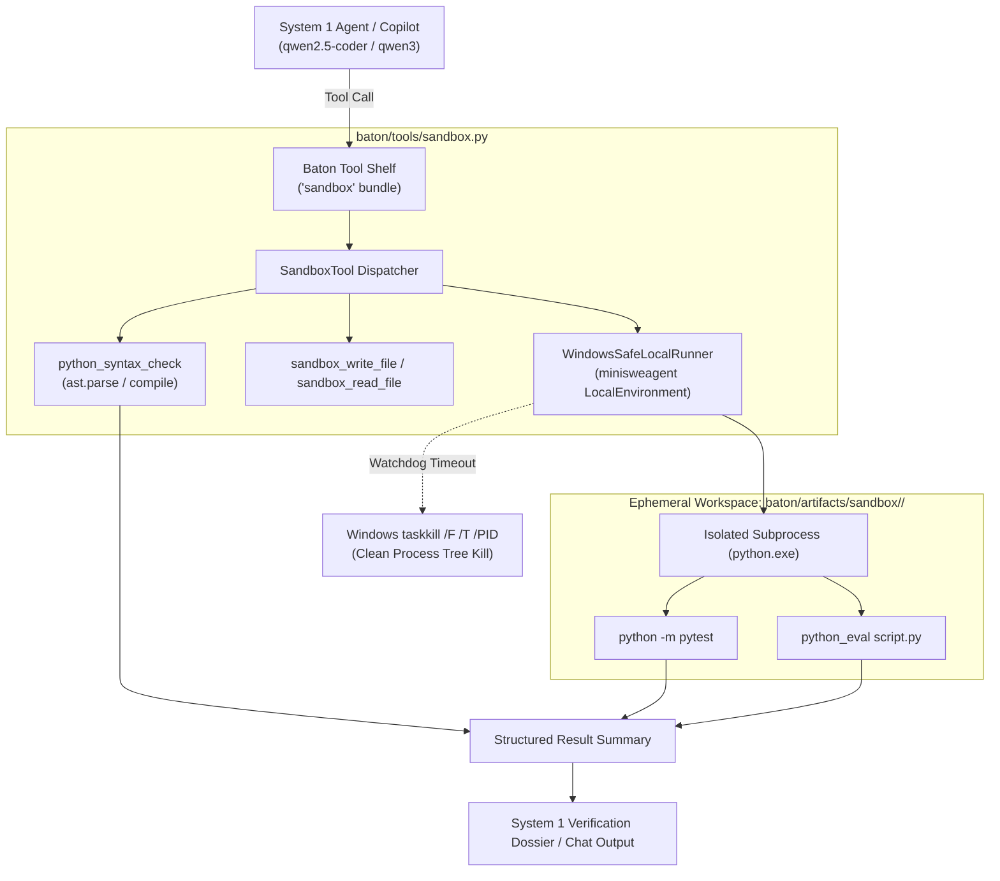

# Subsystem A: Sandboxed Python REPL & Verification Engine
## Engineering Specification & Architecture Design

> **Status:** Architecture & Design Specification · Implementation in Progress  
> **Target Subsystem:** Baton Orchestrator ([`baton/`](file:///e:/dev/Antigravity/local_llm/baton/))  
> **Platform:** Windows 11 64-bit / Anaconda3 Python 3.11 / WSL2  
> **Date:** October 2026  

---

## 1. Executive Summary & Objectives

The **Baton Orchestrator** conducts a dual-speed workflow:
1. **System 1 (Recon & Verifier):** Fast dense models (`qwen3:14b` and `qwen2.5-coder:14b`) running on Ollama @ ~14–28 tok/s.
2. **System 2 (Deep Synthesizer):** Frontier MoE (`DeepSeek-V4-Flash` 284B) running on Colibrì @ ~0.8 tok/s.

While System 2 generates complex mathematical derivations, algorithms, and multi-file code overnight, it is **tool-blind and cannot execute or test its own code**. 

**Subsystem A (Sandboxed Python REPL & Verifier)** provides the deterministic execution and verification environment for System 1. It enables:
- Rapid syntax validation (<1ms AST parsing) of generated code.
- Ephemeral execution of Python code snippets and scripts with stdout/stderr capture.
- Automated unit test execution via `pytest` with structured pass/fail metrics.
- Hard process-tree watchdog enforcement (`taskkill /F /T` on Windows) to prevent infinite loops, hung threads, or orphaned subshells.
- Modular dynamic integration via the **Baton Tool Shelf** (`'sandbox'` bundle).

---

## 2. Architecture & Sandboxing Engine



---

## 3. Core Capabilities & Tool Interfaces

### A. Instant Syntax Validation (`python_syntax_check`)
- **Engine:** Pure Python `ast.parse()` and `compile(..., mode="exec")`.
- **Latency:** **<1 millisecond** (in-process, zero subprocess overhead).
- **Behavior:**
  - If valid: returns `{"valid": True, "message": "Syntax valid. No parsing errors detected."}`.
  - If invalid: extracts `SyntaxError` details (`lineno`, `offset`, `text`, `msg`), formatting a precise diagnostic error snippet.

### B. Isolated Code Evaluation (`python_eval`)
- **Engine:** Python subprocess running in `baton/artifacts/sandbox/<session_id>/`.
- **Environment:**
  - Python binary: `C:\ProgramData\Anaconda3\python.exe`.
  - Injects Anaconda `Scripts/` into `PATH`.
  - Sets `PYTHONPATH` to include both sandbox directory and repository root.
- **Safety:**
  - Default timeout: **30 seconds** (configurable up to 120s).
  - Enforces `taskkill /F /T /PID` on Windows if timeout expires.
  - Output truncation: Capped at **3,500 characters** with total character count metrics to protect LLM context windows.

### C. Automated Unit Test Execution (`pytest_run`)
- **Engine:** Subprocess invocation of `python -m pytest <test_target> -v`.
- **Structured Parsing:**
  - Scans pytest stdout for summary statistics (passed, failed, skipped, error counts).
  - Extracts failure tracebacks and assertion errors.
  - Returns structured JSON for System 1 verification dossiers.

### D. File Staging (`sandbox_write_file` & `sandbox_read_file`)
- Safely writes generated code, dependencies, or test harnesses into the isolated sandbox folder.
- Reads test outputs, generated CSV/JSON artifacts, or logs without touching git-tracked project folders.

---

## 4. Process Safety & Subshell Termination (Windows)

Standard Python `subprocess.Popen.kill()` on Windows terminates only the root process (often `cmd.exe` when `shell=True`). Any child processes (such as `python.exe` executing an infinite loop) are orphaned, remaining resident in memory and locking file handles or stdout pipes.

Building upon the battle-tested patch from [`smart_search/run_agent.py`](file:///e:/dev/Antigravity/local_llm/smart_search/run_agent.py#L415-L426), `WindowsSafeLocalRunner`:
1. Launches processes with `subprocess.Popen(..., stdout=subprocess.PIPE, stderr=subprocess.STDOUT)`.
2. On `subprocess.TimeoutExpired`:
   ```python
   if os.name == "nt":
       subprocess.run(f"taskkill /F /T /PID {process.pid}", shell=True, capture_output=True)
       process.kill()
   else:
       import signal
       os.killpg(process.pid, signal.SIGKILL)
   ```
3. Guarantees that the entire process tree is terminated cleanly within milliseconds.

---

## 5. Tool Shelf Integration Schema

Registered as bundle `'sandbox'` in `TOOL_BUNDLES` ([`baton/chat.py`](file:///e:/dev/Antigravity/local_llm/baton/chat.py)):

```python
SANDBOX_TOOLS_SCHEMA = [
    {
        "type": "function",
        "function": {
            "name": "python_eval",
            "description": "Executes Python code in an isolated sandbox and returns stdout/stderr.",
            "parameters": {
                "type": "object",
                "properties": {
                    "code": {"type": "string", "description": "Python source code to execute."},
                    "timeout": {"type": "integer", "description": "Execution timeout in seconds (default: 30)."}
                },
                "required": ["code"]
            }
        }
    },
    {
        "type": "function",
        "function": {
            "name": "python_syntax_check",
            "description": "Validates Python syntax via AST analysis (<1ms) without executing code.",
            "parameters": {
                "type": "object",
                "properties": {
                    "code": {"type": "string", "description": "Python code to validate."}
                },
                "required": ["code"]
            }
        }
    },
    {
        "type": "function",
        "function": {
            "name": "pytest_run",
            "description": "Runs pytest on a file or directory in the sandbox, returning test outcomes.",
            "parameters": {
                "type": "object",
                "properties": {
                    "target": {"type": "string", "description": "Target test file or test directory path."},
                    "timeout": {"type": "integer", "description": "Timeout in seconds (default: 60)."}
                },
                "required": ["target"]
            }
        }
    },
    {
        "type": "function",
        "function": {
            "name": "sandbox_write_file",
            "description": "Writes a file into the isolated sandbox directory.",
            "parameters": {
                "type": "object",
                "properties": {
                    "filename": {"type": "string", "description": "Relative filename within the sandbox."},
                    "content": {"type": "string", "description": "Content to write into the file."}
                },
                "required": ["filename", "content"]
            }
        }
    },
    {
        "type": "function",
        "function": {
            "name": "sandbox_read_file",
            "description": "Reads a file from the isolated sandbox directory.",
            "parameters": {
                "type": "object",
                "properties": {
                    "filename": {"type": "string", "description": "Relative filename within the sandbox."},
                    "max_chars": {"type": "integer", "description": "Maximum characters to read (default: 3500)."}
                },
                "required": ["filename"]
            }
        }
    }
]
```

---

## 6. Implementation Plan & Phases

* [x] **Design & Architecture Specification:** Documented in `subsystem_a_sandbox_design.md`.
* [x] **Phase 1: Core Engine (`baton/tools/sandbox.py`):**
  - Implement `WindowsSafeLocalRunner`.
  - Implement `SandboxTool` class with `python_eval`, `python_syntax_check`, `pytest_run`, `write_file`, `read_file`.
  - Export `SandboxTool` in `baton/tools/__init__.py`.
* [x] **Phase 2: Tool Shelf Integration (`baton/chat.py`):**
  - Register `SANDBOX_TOOLS_SCHEMA` and `'sandbox'` in `TOOL_BUNDLES`.
  - Wire tool execution handlers into `BatonChatSession.execute_tool()`.
  - Add slash command and CLI flag support (`--bundles sandbox`).
* [x] **Phase 3: System 1 & Verifier Relay Integration (`baton/system1.py`):**
  - Add `sandbox_tool` property to `System1Runner`.
  - Wire `task_type == "fast_verify"` to copy upstream code artifacts into sandbox and run automated tests.
* [x] **Phase 4: Unit Testing & Verification (`baton/tests/test_sandbox.py`):**
  - Unit tests covering AST checking, clean execution, timeout handling, pytest parsing, and shelf bundling.
